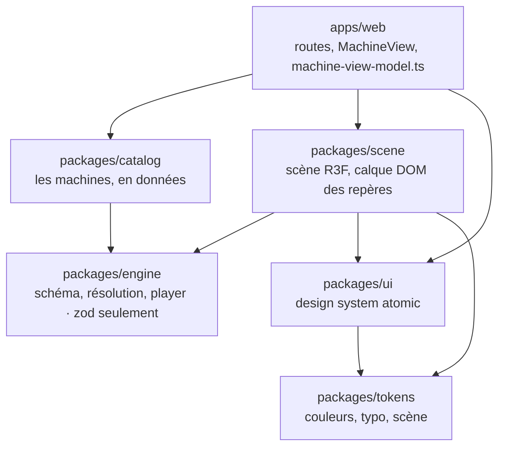

# Nightprint — plan de projet

> Copie du doc Claude « Nightprint — plan de projet » (12/10/2026). Le doc Claude est la version
> qu'on édite ; ce fichier suit. Les agents qui codent dans ce repo le lisent avant d'ajouter une
> fonctionnalité : ce qui est hors du scope v1 attend le lancement.

Nightprint montre l'architecture logicielle sous forme de machines 3D qu'on fait tourner dans le navigateur. Le but : apprendre la vraie 3D et exposer un projet public, sans objectif de revenu. Le lancement se fait avec une seule machine, l'architecture hexagonale (MCH-001), après trois week-ends de build ; ensuite, une machine par semaine.

## Le projet

Nightprint (nightprint.dev) est un site où chaque concept d'architecture devient une machine 3D animée. On regarde une vraie requête la traverser étape par étape, puis on agit dessus (« et si… ») pour voir ce que le concept protège.

**Une machine, c'est :**

- une scène 3D en « dessin d'ingénieur, de nuit » : fond sombre, arêtes fines, quatre couleurs de flux ;
- un scénario guidé (7 étapes pour MCH-001), avec barre de transport et journal d'événements ;
- des interrupteurs « et si… » nommés comme des cas de test (« Swap Postgres for InMemory ») ;
- une nomenclature numérotée et un cartouche, comme sur un plan d'assemblage ;
- un article court, 5 paragraphes au plus, avec ses sources.

**Pour qui.** Les développeurs qui veulent comprendre pourquoi un pattern existe, pas seulement à quoi il ressemble. Le site est en anglais.

**Ce qui le distingue.** Les explications existantes sont des articles 2D (Ben Dicken, Sam Rose), des machines SVG générées par IA (Anatomy), des simulateurs d'infra ou des schémas statiques. Aucune ne combine vraie 3D, patterns d'architecture logicielle, scénarios guidés et actions « et si… ».

**Catalogue prévu.** Backend (hexagonale, DDD, CQRS + event sourcing), frontend (event loop, rendu React), mobile (offline-first), infra (Redis cache-aside, Kafka).

## Buts

Nightprint sert trois buts, dans cet ordre. Il n'a pas d'objectif de revenu.

1. **Apprendre la vraie 3D** : Blender (pièces, export glTF), React Three Fiber avec WebGPU, TSL (arêtes, bloom, faux verre, coupes), et la conception d'un moteur de scénarios typé.
2. **Un projet public pour le portfolio** : il montre l'architecture (le site respecte la règle hexagonale qu'il explique), la 3D et un design system complet.
3. **Du contenu build in public** : X en anglais, LinkedIn en français.

**Hors objectifs** : revenu, comptes utilisateurs, génération de machines par IA en v1, couvrir tous les concepts.

**Critères de réussite (proposés, à valider)**

- [ ] MCH-001 en ligne sur nightprint.dev, jouable de bout en bout sur Chrome et Safari, desktop et mobile, sans erreur en console.
- [ ] MCH-001 relue contre Cockburn (2005), sources citées sur la page.
- [ ] `pnpm check` vert à chaque commit : lint, types, tests, contraste AA.
- [ ] Après le lancement, une machine finie par semaine, jamais deux commencées en même temps.
- [ ] Un post X et un post LinkedIn par machine.

## Scope v1

La v1, c'est le moteur et une seule machine excellente, MCH-001. Tout le reste attend le lancement.

| Élément | Statut | Où en est-on |
| --- | --- | --- |
| Moteur de scénarios : schéma zod, résolution des actions, player déterministe | v1 | Fait, 27 tests |
| MCH-001 hexagonale : 7 étapes, 2 interrupteurs, nomenclature, journal, cartouche, article | v1 | Jouable en primitives depuis le 12/10 |
| Design system en atomic design : tokens et 25 composants | v1 | Fait, publié en artifact |
| Pièces Blender en glTF : cœur en verre, ports, 5 adaptateurs, plaque | v1 | Week-end 1 |
| Caméra entre les étapes, cotes de latence, étincelles de violation | v1 | Week-end 2 |
| Bloom et arêtes en TSL, vue éclatée, coupe hachurée | v1 | Week-end 3 |
| Catalogue avec les machines à venir grisées | v1 | Version simple en place |
| Accessibilité : clavier, réduction des animations, contraste AA testé | v1 | En place |
| Site statique sur le VPS, domaine nightprint.dev | v1 | Domaine à acheter |
| Machines MCH-002 à MCH-008 | Après le lancement | Une par semaine |
| Export vidéo intégré (WebCodecs) | Après le lancement | Capture d'écran au lancement |
| Planche de concepts : grille de mini-machines animées | À trancher | Voir les décisions ouvertes |
| Génération d'une machine par IA à partir d'une phrase | v2 | Claude écrit une définition à partir du kit |
| Éditeur de code intégré (snippet de l'event loop) | v2 | Après le catalogue de base |
| Éditeur visuel, comptes utilisateurs, thème clair | Coupé | Rien de tout ça au lancement |

## Roadmap

Le lancement arrive après trois week-ends de build : autour du 1er novembre s'ils s'enchaînent dès ce week-end. Ensuite, une machine par semaine.

1. **Fait (11 et 12 octobre)** : cadrage, DA, rendu test Blender, nom ; repo (moteur, catalogue, scène, UI, tokens) ; MCH-001 jouable en primitives, design system atomic, 76 tests, skills installés.
2. **Avant le week-end 1** : acheter nightprint.dev, vérifier WebGPU dans Chrome et Safari, `git init` ; storyboard Excalidraw de MCH-001, une image par étape.
3. **Week-end 1, les pièces et la scène** : Blender (cœur en verre, ports, 5 adaptateurs, plaque, export glTF), matières au niveau de la planche ; orbite et zoom bornés, lignes de rappel des repères, cadrage mobile, déploiement sur le VPS.
   Livré : la machine immobile, en ligne.
4. **Week-end 2, le scénario et les actions** : mouvements de caméra entre les étapes, cotes de latence, étincelles de violation ; relecture du parcours « Passer commande » et des deux interrupteurs contre Cockburn.
   Livré : jouable de bout en bout, en ligne.
5. **Week-end 3, finitions et lancement** : bloom et arêtes en TSL, vue éclatée, coupe hachurée, catalogue avec les machines à venir ; capture vidéo pour X et LinkedIn.
   **Lancement public de MCH-001.**
6. **Ensuite, une machine par semaine** : MCH-002 event loop JavaScript → 003 DDD → 004 offline-first → 005 CQRS + event sourcing → 006 rendu React → 007 Redis cache-aside → 008 Kafka.

Chaque week-end se termine par une livraison en ligne. L'ordre des machines après le lancement est indicatif.

## Architecture et stack

Un monorepo de cinq paquets et une app. La règle hexagonale que le site explique, il l'applique : le moteur ne connaît ni React, ni three, ni le DOM, et les `package.json` l'imposent.



Flèche = « importe ». `apps/web` importe aussi `engine` et `tokens` directement. Le détail est dans `CLAUDE.md`.

| Brique | Choix | Pourquoi |
| --- | --- | --- |
| Monorepo | pnpm 10.28 + Turborepo 2.11 | Les `package.json` imposent les frontières entre paquets |
| Site | Next.js 16.4, App Router, export statique | Une page HTML par machine, ni base ni comptes |
| 3D | React Three Fiber 9.8 + three 0.186, `WebGPURenderer` | Repli WebGL2 automatique ; R3F v10 encore en alpha |
| Langage | TypeScript 6.0.3 | TS 7 n'a plus l'API JS dont `next build` a besoin pour typer |
| Données | zod 4 | Machines validées au chargement |
| Tests et lint | Vitest 5, Biome 2 | 76 tests ; Biome remplace ESLint et Prettier |
| Styles | Tailwind 4, palette par défaut supprimée | Seules les couleurs de la DA existent |
| Polices | IBM Plex Sans et Mono, auto-hébergées | Build hors ligne, licence OFL |
| Hébergement | VPS perso, site statique derrière Caddy | Déploiement à brancher sur la CI GitHub Actions existante |

## Règles du projet

Quand un choix hésite, ces règles tranchent. Elles sont détaillées dans `CLAUDE.md` et le skill `nightprint-conventions`.

1. **Une machine est une donnée.** Un fichier dans `packages/catalog`, validé par zod pour chaque combinaison d'interrupteurs : une étape cassée casse le build.
2. **La 2e machine dicte l'abstraction.** Aucune fonctionnalité de schéma « pour plus tard ».
3. **L'exactitude d'abord.** Chaque machine cite une référence et ne suggère jamais un comportement que le vrai système n'a pas.
4. **Le temps vit dans le moteur.** Pas fixe de 1/60 s, aucune valeur par image dans l'état React.
5. **Rendu compatible WebGPU.** Matériaux natifs ou nodes, TSL ; ni GLSL ni `@react-three/postprocessing` ; repères en DOM au-dessus du canvas.
6. **Les tokens seulement.** Quatre couleurs de flux ; le vermillon est réservé aux erreurs et aux violations.
7. **Atomic design pour l'interface.** Atomes, molécules, organismes, templates, pages ; `ui` ne connaît pas le moteur.
8. **Contenu public générique.** Exemples métier (commande, paiement), aucun nom d'entreprise, de produit ou de client réel ; noms de technos en texte, pas de logos.
9. **Une machine finie par semaine**, pas cinq commencées.

## Build in public

Le build se raconte en anglais sur X et en français sur LinkedIn ; chaque machine donne au moins un post.

- **Lancement** : la vidéo de MCH-001, centrée sur le déclic « je remplace Postgres, le cœur ne bouge pas ». Anatomy est cité comme inspiration dès ce premier post.
- **Série « une machine par semaine »** : le concept en une phrase, la vidéo, l'interrupteur qui fait comprendre.
- **Coulisses** : croquis Excalidraw, puis pièce Blender, puis la même dans le navigateur ; pourquoi la vraie 3D plutôt que le SVG ; la coupe hachurée en TSL.
- **Angles déjà tirés du build** :
  - le site respecte la règle hexagonale qu'il explique, et le compilateur l'impose ;
  - « j'ai failli publier un contre-exemple faux » : contourner un port n'inverse pas une dépendance ;
  - pourquoi pas TypeScript 7 dans un projet Next.js en octobre 2026 ;
  - une machine = un fichier de données, validé pour les 2^n combinaisons d'interrupteurs ;
  - pas fixe de 1/60 s, donc export vidéo exact image par image ;
  - palette Tailwind supprimée, contraste testé en CI ;
  - drei `<Html>` + Strict Mode = 9 erreurs React par page, remplacé par un calque DOM.
- **Interaction** : demander en réponse quel concept devient la machine suivante.
- **Réseau** : Ben Dicken, Sam Rose et l'auteur d'Anatomy font le même métier d'explication. Les citer, leur répondre avec les machines, ne pas les copier.

## Risques et garde-fous

Le plus gros risque n'est pas technique : c'est un projet d'apprentissage sans problème vécu derrière, qui doit tenir sur des soirs et des week-ends.

| Risque | Garde-fou |
| --- | --- |
| La motivation retombe, faute de problème vécu à résoudre | Scope court, une livraison visible par week-end, un post à chaque étape |
| Le temps manque (soirs et week-ends) | MVP en 3 week-ends, rien hors scope avant le lancement |
| Le catalogue gonfle | Une machine finie par semaine, dans l'ordre fixé |
| Le moteur devient générique trop tôt | Il s'extrait de la 1re et de la 2e machine, pas avant |
| Un schéma faux se fait démonter | Relecture contre une source de référence, sources citées sur la page |
| La métaphore trompe | La machine ne suggère jamais un comportement faux pour faire joli |
| WebGPU instable (erreur `swizzle` vue dans Chromium headless) | Tester Chrome et Safari réels ; forcer WebGL2 si un bug bloque plus d'une soirée |
| Trop proche d'Anatomy ou d'ISO-GLOW | Signatures propres : repères, nomenclature, cotes, coupe, cartouche ; ni leur code, ni leur palette |
| Mobile trop lent (verre, bloom) | Faux verre (fresnel + transparence), bloom discret, test sur téléphone |

## Décisions ouvertes et prochaines actions

Une décision reste à prendre, plus la licence du repo ; les autres lignes sont à faire avant le week-end 1.

- [ ] **Planche de concepts** : vitrine des 8 machines complètes, ou format à part avec beaucoup de petits concepts (DNS, CDN, load balancer…) dont certains deviennent des machines ?
- [x] **Compte X** : le compte perso, [@ewenlq](https://x.com/ewenlq) (décidé le 12/10). Il signe les pages (auteur, carte X) et le journal de build y renvoie.
- [x] **Repo** : public sur GitHub, [Ewen02/nightprint](https://github.com/Ewen02/nightprint) (décidé le 12/10). Reste à choisir la licence.
- [ ] Acheter nightprint.dev (libre au registre le 12/10).
- [ ] Vérifier WebGPU dans Chrome et Safari réels : aucune erreur `swizzle` en console.
- [x] `git init` et premiers commits, atomiques (12/10).
- [ ] Storyboard Excalidraw de MCH-001, une image par étape.
- [ ] Valider les critères de réussite de la section Buts.

## Démarrer dans le repo

Il faut Node 22.12 ou plus et pnpm 10.

```bash
pnpm install   # dépendances
pnpm dev       # construit les tokens, puis next dev
pnpm check     # Biome + types + tests, avant chaque commit
pnpm build     # export statique dans apps/web/out
```

- **À lire d'abord** : `CLAUDE.md` (règles, versions, docs embarquées de Next.js et Turborepo), puis `.claude/skills/nightprint-conventions`.
- **Ajouter une machine** : un fichier dans `packages/catalog/src` et une ligne dans `index.ts`. `pnpm check` la rejoue pour chaque combinaison d'interrupteurs.
- **Ajouter un composant** : au bon niveau de `packages/ui/src` (atoms, molecules, organisms, templates), avec des props simples, puis `pnpm --filter @nightprint/ui design-system` pour régénérer l'artifact du design system.
